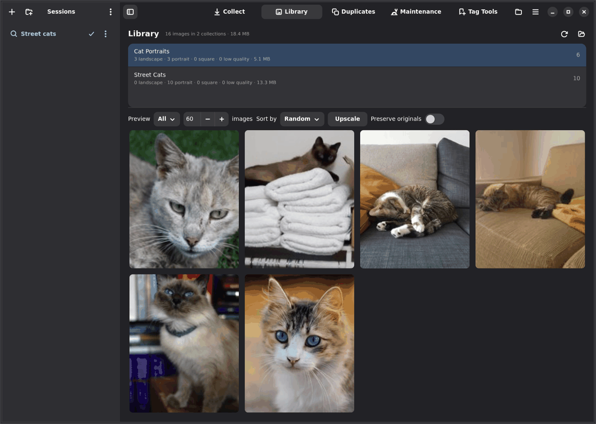
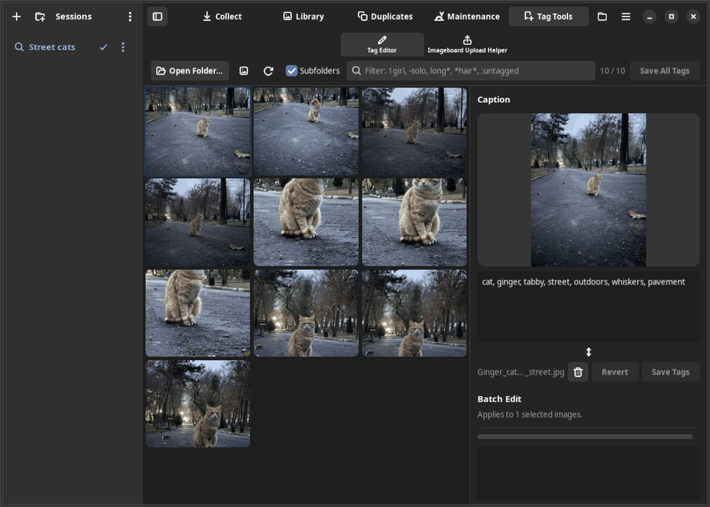
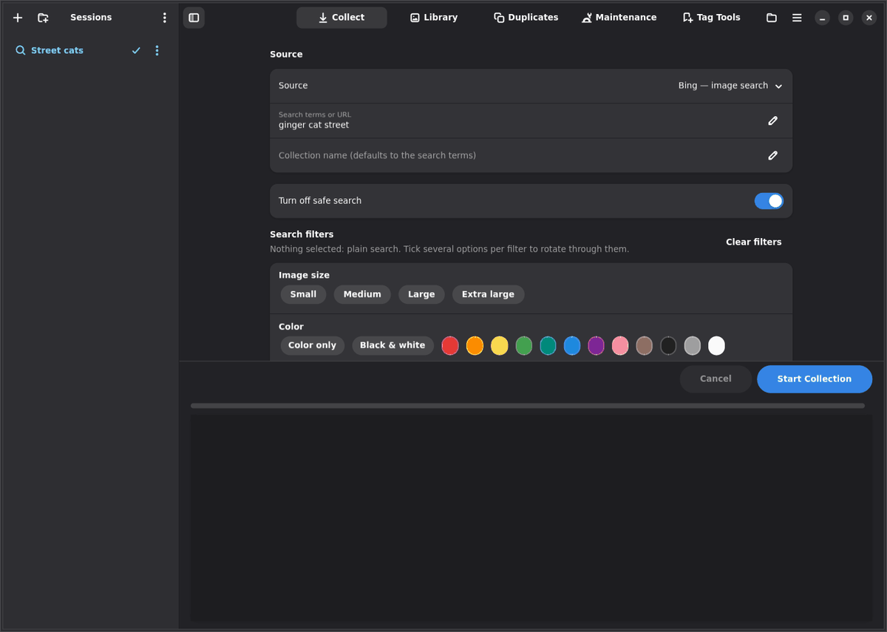
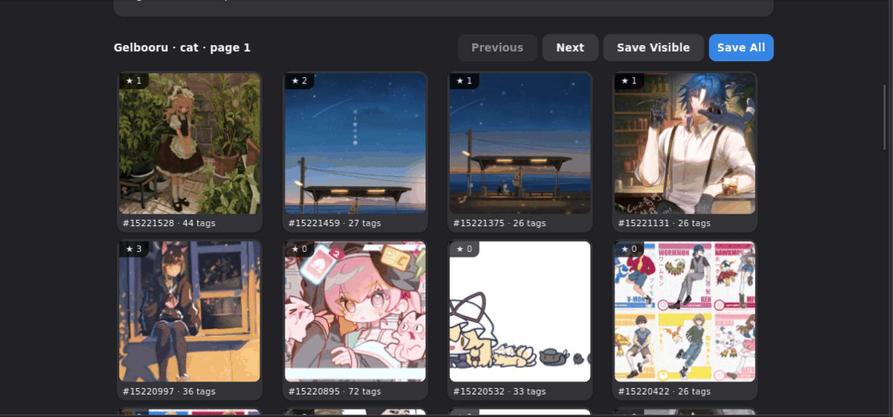
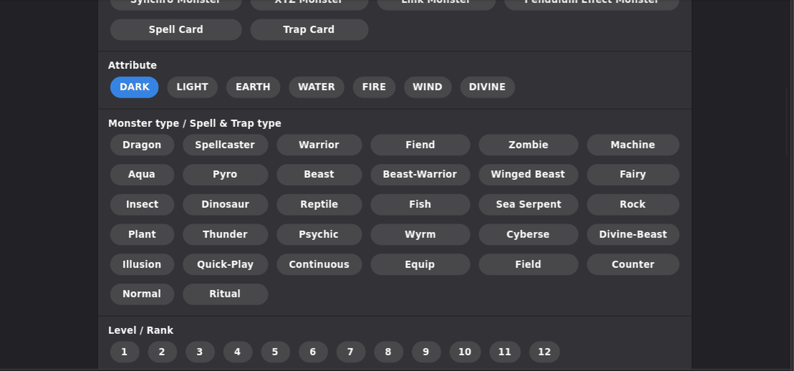
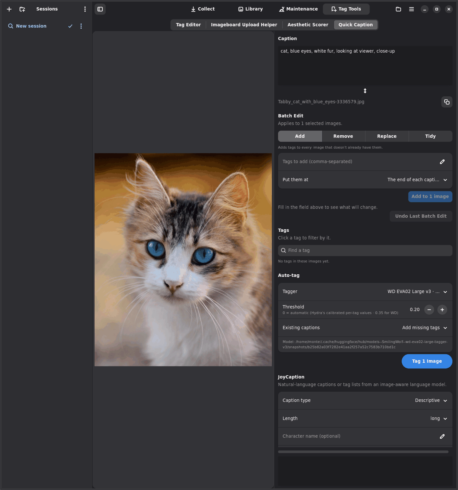
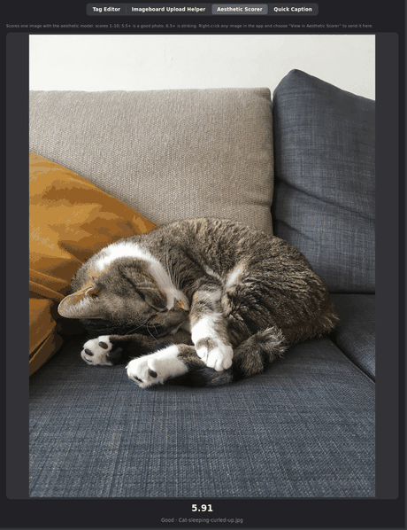
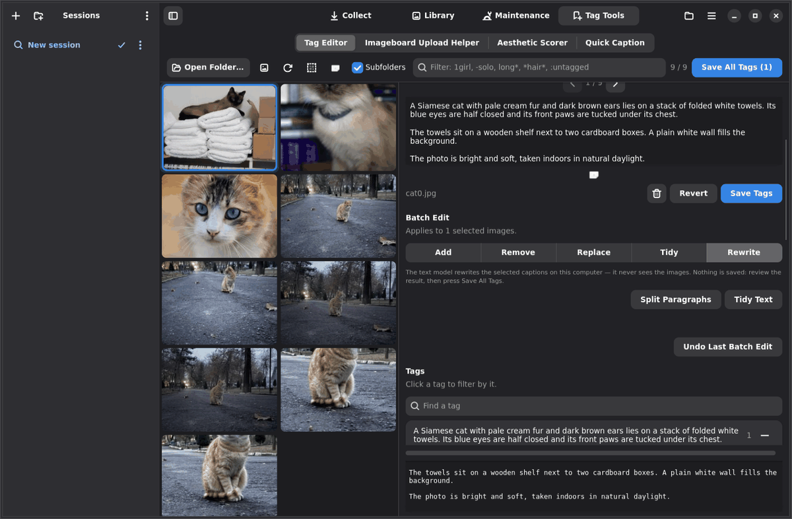
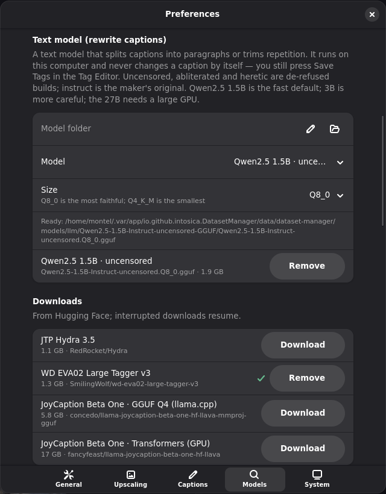

  

<h1 align="center">Dataset Manager</h1>

Collect, organize, caption and de-duplicate image datasets. 
A native GNOME app (GTK 4 + libadwaita), also at home on COSMIC and other desktops.

## Install

### Flatpak (recommended; works on Wayland and X11/Xorg)

    ./build-flatpak.sh                  # build + install for your user; run again whenever you want to update
    flatpak run io.github.intosica.DatasetManager

Needs `flatpak` and `flatpak-builder`; the script installs the GNOME 50 runtime/SDK from Flathub if missing. Python
packages and Playwright's Chromium are downloaded during the build (several GB of cache in
`~/.cache/dataset-manager-flatpak`, override with `FLATPAK_BUILD_DIR`).

| Option | Effect |
|---|---|
| `--extras "pkg …"` | pip packages baked in. Default `"imageprism onnxruntime transformers"` (light ONNX similarity models); add `torch open_clip_torch torchvision` for TinyCLIP / OpenCLIP / MobileNet, `torch spandrel` for AI upscaling |
| `--bundle` | also writes a single-file `dataset-manager.flatpak` |
| `--clean` | wipes the build cache first |

The flatpak can read and write your home folder, `/media`, `/run/media` and `/mnt`. Its settings and sessions live in
`~/.var/app/io.github.intosica.DatasetManager/`.

### Without Flatpak

    sudo apt install python3-gi gir1.2-adw-1 gir1.2-gtk-4.0       # PyGObject + libadwaita (Debian/Ubuntu/Pop!_OS)
    python3 -m venv --system-site-packages venv
    venv/bin/pip install -r requirements.txt
    venv/bin/playwright install chromium                          # only if you have no Chrome/Chromium
    ./run.sh
    ./install-launcher.sh                                         # optional: application menu entry

## Layout

The pages are in the header bar (Ctrl+1 … Ctrl+4); the left sidebar holds your **sessions**.

| Page | What it does |
|---|---|
| Collect | Image search (Bing, DuckDuckGo, Yahoo, Yandex, Pinterest, Internet Archive), imageboards with an in-app viewer (Danbooru, Gelbooru; Rule34.xxx after you switch on **Mature content** in Preferences), YGOPRODeck card art and card-art galleries (ArtofMTG, MTG Nexus) |
| Library | Per-collection statistics and thumbnail previews; right-click a preview to move it to the Trash |
| Maintenance | Optional steps for the **highlighted collection** (or the whole library if none is picked): dedupe (review the groups first, or trash copies automatically), sort, rename, JPEG, resize, low-quality flagging, captions |
| Tag Tools | **Tag Editor**: browse a dataset, filter by tags, edit captions one by one or in batches (save one image or all of them; double-click the preview for a closer look), auto-tag (JTP Hydra 3.5, WD EVA02 Large v3) and caption with JoyCaption. Batch Edit has Add / Remove / Replace / Tidy / Rewrite tabs with a live “will change N captions” line and Undo. Selected thumbnails are outlined, Select all / Select none sit in the toolbar, and the arrows under the preview step through the filtered grid. A **local text model** (Qwen2.5 by default) can split a caption into paragraphs or tidy away repetition (text only, on this computer). **Imageboard Upload Helper**: turns tag lists into imageboard upload format. **Aesthetic Scorer**: click or drop any image to score it. **Quick Caption**: a throw-away one-image Tag Editor (tagging and captioning, nothing is saved) |

Right-click any image in the app to move it to the Trash (Library, Tag Editor), or to open it in the **Aesthetic Scorer** or **Quick Caption**.

The window adapts to narrow sizes: the sidebar collapses and the page switcher moves to the bottom.

| Tag Tools → Tag Editor | Collect |
|---|---|
|  |  |

### Imageboards, YGOPRODeck and the new tools

Imageboard searches run in a hidden browser (no window appears, whatever “Run the browser without a window” says).
Videos and animated GIFs are left out. Danbooru only lets anonymous users search two tags, so the first two go to the
server and the rest are applied locally; Gelbooru's practical limit is about 11 tags. The app shows a notice when
either happens. Danbooru also sits behind an interactive Cloudflare check that a hidden browser cannot pass, so the
app tells you so and suggests Gelbooru.

| Gelbooru: “cat” | YGOPRODeck: archetype “Archfiend” (cropped card art) |
|---|---|
|  |  |

| Quick Caption | Aesthetic Scorer |
|---|---|
|  |  |

Screenshots use a small demo library of [CC0](https://creativecommons.org/publicdomain/zero/1.0/) cat photographs from
Wikimedia Commons.

### Text model: paragraphs and tidying

The Tag Editor can rewrite a caption with a small local text model (any instruct GGUF, run through llama.cpp on this
computer). The default is [Qwen2.5 1.5B Instruct uncensored](https://huggingface.co/mradermacher/Qwen2.5-1.5B-Instruct-uncensored-GGUF)
at Q8_0 (1.9 GB): fast on a CPU, and the prompts are tuned for it.

* **Split Paragraphs** groups the caption's sentences into subject → setting → style paragraphs. The model only
  labels each sentence; the words themselves are never rewritten, so nothing gets lost or invented. Captions saved
  that way keep their blank lines in the `.txt` sidecar (`first paragraph↵↵second paragraph`).
* **Tidy Text** rewrites the caption as one paragraph without repetition, keeping every object, colour, number and
  action.
* Tag lists (no sentences) are left alone by both; Batch Edit → **Tidy** is the tool for those.
* The two buttons under the caption work on the open image, on every selected image, or on all shown images when none
  is selected (the label shows the count); **Batch Edit → Rewrite** has the same two.
* A rewrite is staged like any other edit. Nothing is written until you press **Save Tags** / **Save All Tags**, and
  **Undo Last Batch Edit** takes it back.

Preferences → Models → **Text model** picks the model and the size (Q4_K_M … Q8_0), then downloads it from Hugging
Face:

| Model | Q8_0 | Notes |
|---|---|---|
| [Qwen2.5 1.5B · uncensored](https://huggingface.co/mradermacher/Qwen2.5-1.5B-Instruct-uncensored-GGUF) | 1.9 GB | default, tested |
| [Qwen2.5 1.5B · instruct](https://huggingface.co/Qwen/Qwen2.5-1.5B-Instruct-GGUF) | 1.9 GB | Qwen's original |
| [Qwen2.5 3B · abliterated](https://huggingface.co/mradermacher/Qwen2.5-3B-Instruct-abliterated-GGUF) | 3.3 GB | slower, more careful |
| [Qwen2.5 3B · instruct](https://huggingface.co/Qwen/Qwen2.5-3B-Instruct-GGUF) | 3.6 GB | Qwen's original |
| [Qwen3.8 27B · uncensored](https://huggingface.co/philbert440/Qwen3.8-27B-Uncensored-Cyber-GGUF) | 29 GB | untested; needs a big GPU and a recent llama.cpp |
| Phi-4 mini · instruct / abliterated / heretic | 3.8 GB | the earlier default |

It needs `llama-cpp-python` (Preferences → System; CPU build, no GPU required). The model never sees the image: the
caption is the only input. On a 12-core CPU a split takes 2–7 s and a tidy 5–12 s with the 1.5B Q8_0.

Every download in Preferences has a **Remove** button — taggers, JoyCaption, Florence 2, the text model and the cached
CLIP / similarity / aesthetic models — so a model you no longer use does not stay on disk.

### Sessions

A session is a saved set of Collect settings (source, query, filters, options, seed images, similarity filter,
aesthetic score).

* There is always one active session. Whatever you change on the Collect page is saved into it straight away, and a
  session named after nothing follows the search terms until you rename it.
* **+** starts a new blank session; click a session to load it; Start Collection keeps working in the active one.
* Drag sessions to reorder them or into folders; use the ⋮ menu to rename, duplicate or delete; ⋮ in the header sorts A–Z.
* Sessions are stored in `sessions.json` in the config folder.

## Collecting

* **Search filters** follow the selected engine (size, colour, type, layout, people, date, license, …). Unlike on the
  websites you can tick several options per filter: the scraper visits every combination in random order
  (a random 64 if there are more) and splits the image budget between them.
* **Turn off safe search** works for Bing, DuckDuckGo, Yahoo and Yandex.
* **Sort into Portrait / Landscape / Square folders** can be switched off to save everything into the collection folder.
* **Visually similar images (Bing, Yandex)** — give a seed: an image file, a folder of images (a random few are used), or an
  image URL. The scraper uploads each seed to the engine's visual search and downloads only the
  *visually similar* results, not the identification of the picture. While a seed is set the scrape is visual only —
  the search terms are ignored — and it keeps going deeper: Bing's grid loads more on scroll, Yandex's orange
  "Show more" button (under the cookie banner) is pressed for another pageful until the cap or a robot check. Clear the
  seed to search by text again.
* **Keep only images that look like my examples** — a per-session similarity filter, always editable. Choose a model, a
  folder of images to go for and (optionally) a folder of images to avoid. Each download is scored as
  `mean similarity to "look like" − mean similarity to "don't look like"`; images at or below the threshold are skipped.

  | Model | Size | Install |
  |---|---|---|
  | imgbeddings (CLIP ViT-B/32, ONNX) | ~88 MB | `pip install onnxruntime transformers` |
  | TinyCLIP ViT-8M | ~40 MB | `pip install torch transformers` |
  | imageprism — semantic / style / instance | 14–90 MB | `pip install imageprism` |
  | OpenCLIP ViT-B/32 | ~600 MB | `pip install torch open_clip_torch` |
  | MobileNetV3 | ~20 MB | `pip install torch torchvision` |

  Models download on first use; example embeddings are cached.
* **Aesthetic score** — switch it on per session to score every download 1–10 with
  [aesthetic-predictor-v2-5](https://github.com/discus0434/aesthetic-predictor-v2-5) and keep only images at or above
  the minimum (5.5 is a decent photo, 6.5+ is striking). Needs `pip install aesthetic-predictor-v2-5` (~1.6 GB of
  torch weights, downloaded on the first run). Skipped downloads do not count towards the image limit.
* **Human-like browsing** — clicks and scrolling are not mechanical: the pointer glides along a slightly curved path to
  a random spot inside a button, the wheel scrolls in uneven bursts from a random position (with the odd glance back
  up), and the safe-search settings are clicked the same way. That keeps robot checks rarer, especially on Yandex.

## Optional packages

Nothing beyond PyGObject is required to launch the app, but collection needs Playwright and some filters need extra
packages. **Preferences → System** lists every optional component: hits **Install** to run pip for you, either into a
**virtual environment** (default: `<app data>/venv`, the flatpak runtime stays untouched) or into your **user's system
site-packages** — your choice, changeable at any time, and the folder of the virtual environment can be moved
somewhere else. On start-up the app looks in whichever one you chose (and in the system) for each module, so installed
packages are picked up without a restart. Post-install steps such as `playwright install chromium` run automatically.

Preferences (Ctrl+,) also holds the library folder, browser, upscale model, model folders, resize defaults and the
caption template; changes apply immediately, and every downloaded model can be removed again from there.

## Where things are stored

Settings and sessions `~/.config/dataset-manager/`, cache `~/.cache/dataset-manager/`, browser profile
`~/.local/share/dataset-manager/` (inside `~/.var/app/…` for the flatpak); downloaded models go to its `models/`
folder (text models: `models/llm/<repo>/`). Create an empty file named `portable` in
this folder to keep everything in `./data` instead. Upscale models are searched in `./models`, `./upscaler` and any
folders added in Preferences. The command line accepts `--library PATH`.
